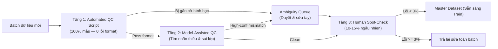

# Annotation Guideline & QC Playbook — AIInAction RoboTaxi (11 Classes)

Tài liệu này dùng làm chuẩn thống nhất cho toàn đội khi gán nhãn, chuyển đổi dữ liệu công khai (public datasets) và kiểm soát chất lượng (QC) trước khi đưa vào huấn luyện `yolo26n-seg` (`imgsz = 640`).

---

## Phần 1: Annotation Guideline (Hướng Dẫn Gán Nhãn Chuẩn)

### 1.1. Nguyên tắc chung (YOLO-seg Polygon)
1. **Ôm sát đường viền (Tight Polygon)**: Vẽ đa giác bám sát biên thật của đối tượng, không vẽ thừa nền trời/đường quá rộng, nhưng cũng không cắt lẹm vào thân đối tượng.
2. **Định dạng & Độ mịn**: Mỗi đối tượng là **1 dòng** trong file `.txt`: `<class_id> <x1> <y1> <x2> <y2> ...` (tọa độ chuẩn hóa `[0, 1]`, tối thiểu 3 đỉnh). Không dùng hình chữ nhật 4 điểm thay cho polygon đối tượng cong/nghiêng.
3. **Mỗi instance một mask riêng**: Trong dòng xe máy dày đặc, tuyệt đối **không** gộp nhiều xe máy cạnh nhau thành một mask lớn.
4. **Ảnh không có đối tượng**: Phải giữ tệp `.txt` **rỗng (0 byte)** tương ứng trong `labels/`.
5. **Không gán nhãn nhiễu**: Không gán nhãn cho hình phản chiếu trên kính/gương/vũng nước, hoặc các vật thể quá mờ/quá xa không thể nhận diện bằng mắt thường (`< 8×8 px` ở ảnh gốc).

---

### 1.2. Quy tắc chi tiết từng lớp & Edge Cases bắt buộc

| ID | Lớp | Quy tắc bao phủ (Include) | Cấm / Loại trừ (Exclude) & Edge Case |
| :-: | :--- | :--- | :--- |
| `0` | **Car** | Sedan, SUV, hatchback, minivan, xe 7 chỗ, bán tải, taxi, xe điện du lịch, xe cứu thương dạng van, **xe 9–15 chỗ** (limousine, Ford Transit bản <16 chỗ). | **KHÔNG** gán xe từ 16 chỗ trở lên. |
| `1` | **Bus** | Xe buýt đô thị, xe khách, xe du lịch **từ 16 chỗ trở lên** (Transit 16c, Solati, County, Universe...). | **KHÔNG** gán xe 9–15 chỗ (`0`) hoặc xe tải thùng kín (`2`). |
| `2` | **Truck** | Xe tải các cỡ (tải nhẹ, tải nặng), xe ben, xe bồn, xe cứu hỏa, **phần cabin + thân xe đầu kéo**. | **QUAN TRỌNG:** Với xe đầu kéo kéo theo rơ-moóc/container, **CHỈ khoanh cabin & thân đầu kéo**. Tuyệt đối **KHÔNG** khoanh chung phần rơ-moóc phía sau. |
| `3` | **Other vehicle** | Ba gác máy, xích lô, xe lam, xe công trình (máy xúc, xe lu, xe cẩu, xe nâng), xe máy cày, **rơ-moóc và sơ-mi rơ-moóc**, mọi phương tiện khác không thuộc `0,1,2,4,5,6,7`. | Phần đầu kéo vẫn là `2`; chỉ rơ-moóc/thùng container kéo theo mới là `3`. |
| `4` | **Motorcycle** | Xe máy, xe tay ga, xe mô tô, xe điện 2 bánh kiểu xe máy **KHÔNG có người ngồi** (đang dựng/đỗ hoặc **đang được người dắt bộ**). | Nếu có ít nhất 1 người đang ngồi trên yên → chuyển sang `5`. |
| `5` | **Motorcyclist** | Xe máy **CÓ ít nhất 1 người ngồi**: vẽ **1 polygon DUY NHẤT** phủ trùm **CẢ xe + TẤT CẢ người ngồi trên xe** (người lái, người ngồi sau, trẻ em) + **hàng hóa cồng kềnh** đang chở trên xe/người. | **KHÔNG** tách riêng người ngồi trên xe thành `8 = Pedestrian`. Nếu người chỉ đứng sát cạnh xe đang đỗ (chân không kẹp xe, không ngồi trên yên) → tách `4` + `8`. |
| `6` | **Bicycle** | Xe đạp, xe đạp điện kiểu xe đạp **KHÔNG có người ngồi** (đang đỗ hoặc **đang dắt bộ**). | Nếu có người ngồi đạp → chuyển sang `7`. |
| `7` | **Cyclist** | Xe đạp **CÓ người đi**: vẽ **1 polygon DUY NHẤT** phủ trùm **CẢ xe đạp + người đi**. | **KHÔNG** tách riêng người đạp thành `8 = Pedestrian`. |
| `8` | **Pedestrian** | Mọi người **KHÔNG ngồi trên phương tiện**: người đi bộ, đứng, ngồi vỉa hè, trẻ em, **người đang dắt xe máy/xe đạp**. | Người ngồi trên xe máy/xe đạp (`5`/`7`) hoặc người ngồi hẳn trong xe ba gác/xích lô (nếu khuất trong phương tiện) không tách làm Pedestrian. |
| `9` | **Sign** | Biển báo hiệu đường bộ, biển chỉ dẫn, biển công trường. **CHỈ phủ phần mặt biển**. | **TUYỆT ĐỐI KHÔNG phủ cột / trụ / giá treo**. Nếu trên một cột có 2 biển tách rời rõ ràng → vẽ 2 polygon riêng. |
| `10` | **Traffic light** | **CẢ hộp đèn tín hiệu giao thông** (đèn xe cộ và đèn người đi bộ). | **KHÔNG** chỉ khoanh mỗi bóng đèn đang sáng. **KHÔNG** phủ cột hay cần vươn gắn đèn. |

---

### 1.3. Cây quyết định nhanh (Decision Tree) cho các ca mập mờ

```text
[Thấy người gần xe 2 bánh]
  ├── Người đang ngồi trên yên (hoặc 1 chân chống đất nhưng vẫn ngồi trên yên)?
  │     └── CÓ ──▶ Gộp 1 mask duy nhất: 5 (Motorcyclist) hoặc 7 (Cyclist)
  └── Người đứng dưới đất (đang dắt xe, đang khóa xe, hoặc đứng cạnh xe đỗ)?
        └── CÓ ──▶ Tách 2 mask: Người = 8 (Pedestrian) | Xe = 4 (Motorcycle) hoặc 6 (Bicycle)

[Thấy xe tải lớn / container]
  ├── Xe tải liền khối (thùng gắn liền khung)? ──▶ 1 mask: 2 (Truck)
  └── Xe đầu kéo có khớp nối kéo theo rơ-moóc?
        ├── Phần cabin + thân đầu kéo ──▶ 2 (Truck)
        └── Phần rơ-moóc / container ──▶ 3 (Other vehicle)

[Thấy xe khách cỡ trung]
  ├── ≥ 16 chỗ (Transit 16c, Solati, xe buýt, xe khách lớn) ──▶ 1 (Bus)
  └── < 16 chỗ (Limousine 9-11c, van, 7 chỗ, bán tải) ──▶ 0 (Car)
```

---

## Phần 2: Quy Trình QC (Quality Control) 3 Tầng

Mọi batch dữ liệu (từ Public Dataset, SAM 2 Box-to-Mask, Pseudo-label hay tự gán tay) **bắt buộc** phải đi qua 3 tầng QC trước khi gộp vào Master Dataset để train.



### Tầng 1: Automated QC Gate (Tự động 100% bằng `validate_dataset.py`)
Kiểm tra toàn bộ lỗi kỹ thuật và **cảnh báo hình học đặc thù edge case**:
1. **Format & Integrity Checks (Bắt buộc 0 lỗi)**:
   - Mỗi ảnh trong `images/` phải có đúng 1 `.txt` tương ứng trong `labels/` (không thừa, không thiếu).
   - `class_id` là số nguyên thuộc `[0, 10]`.
   - Mọi tọa độ `x, y ∈ [0.0, 1.0]`, số lượng tọa độ chẵn và `≥ 6` (tối thiểu 3 đỉnh).
   - Không có `NaN`, `Inf`, polygon tự cắt hoặc diện tích suy biến (`area <= 1e-5`).
2. **Heuristic Edge-Case Flags (Đẩy vào Ambiguity Queue để duyệt)**:
   - **Rider-Leak Flag (Lỗi `4+8` thay vì `5`, `6+8` thay vì `7`)**: Phát hiện cặp `(Pedestrian, Motorcycle/Bicycle)` có `IoU > 0.10` hoặc tâm `Pedestrian` nằm phía trên/trong vùng mở rộng của bbox xe → nghi ngờ **quên gộp mask**.
   - **Duplicate Flag**: Hai polygon cùng lớp có `IoU > 0.85` → nghi ngờ trùng lặp nhãn.
   - **Sign-Pole Flag (Lỗi `9 = Sign` dính cột)**: Polygon lớp `9` có tỷ lệ `height / width > 3.5` và diện tích lớn bất thường → nghi ngờ khoanh cả cột biển báo.
   - **Light-Bulb Flag (Lỗi `10 = Traffic light` chỉ khoanh bóng)**: Polygon lớp `10` có hình tròn/vuông quá nhỏ (`aspect_ratio ≈ 1.0`) nằm ngay sát một hộp đèn khác hoặc không bao trọn khung chữ nhật của hộp đèn.
   - **Trailer-Merge Flag (Lỗi `2 = Truck` gộp cả rơ-moóc)**: Polygon lớp `2` có chiều dài ngang quá lớn (`width > 0.5 * img_width` và `width / height > 2.5`) → kiểm tra xem có phải đầu kéo + rơ-moóc chưa tách sang `3`.

### Tầng 2: Model-Assisted QC (Confident Learning / Disagreement Mining)
Sau khi có model từ Iteration 1 trở đi, chạy inference chính model đó lên tập Train (hoặc batch mới) với ngưỡng `conf = 0.25`:
1. **Missing Label Detection**: Model dự đoán `conf ≥ 0.75` nhưng không khớp với bất kỳ Ground Truth nào (`IoU < 0.2`) → **khả năng cao người gán bị sót đối tượng** (rất hay gặp ở dòng xe máy đông đúc hoặc biển báo nhỏ).
2. **Wrong Class Detection**: Model dự đoán `conf ≥ 0.75` tại vị trí khớp GT (`IoU ≥ 0.6`) nhưng **khác `class_id`** (đặc biệt các cặp `0 vs 1`, `2 vs 3`, `4 vs 5`, `6 vs 7`) → ưu tiên kiểm tra sửa lại nhãn.
3. **Bad Mask Boundary**: Cùng `class_id`, bbox khớp tốt (`bbox_IoU ≥ 0.75`) nhưng `mask_IoU < 0.5` → kiểm tra lại chất lượng viền polygon.

### Tầng 3: Human Audit & Tiêu chuẩn nghiệm thu Batch (Sign-off Checklist)
- **Phân công**: Người gán nhãn và người QC **không trùng nhau** (cross-review) cho các batch ảnh Việt Nam tự gán/sửa.
- **Tỷ lệ kiểm tra**:
  - **100%** các ảnh bị gắn cờ trong *Ambiguity Queue* (từ Tầng 1 & Tầng 2).
  - **10–15%** mẫu ngẫu nhiên trên phần còn lại của batch (tối thiểu 30 ảnh/batch).
- **Điều kiện Pass (Đạt chuẩn gộp vào Master Dataset)**:
  - [ ] Tầng 1 Automated QC: **0 lỗi định dạng**.
  - [ ] Tỷ lệ lỗi trên mẫu random spot-check: **< 3% số instance**.
  - [ ] **0% lỗi quy ước nghiêm trọng** ở 4 nhóm edge case: *(1) gộp `5`/`7`, (2) tách đầu kéo `2` và rơ-moóc `3`, (3) mặt biển `9` không cột, (4) cả hộp đèn `10`*.
  - [ ] Đã cập nhật đầy đủ nguồn, URL, license, số ảnh và bảng mapping vào `datasets_registry.md`.
