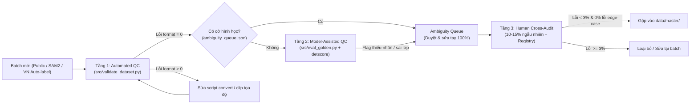

# Annotation Guideline & QC Playbook v2 — Đội 34 (Nguyễn Bá Duy | `TEAM_ID = 39`)

> **Đồng bộ với hợp đồng chấm điểm thực tế (`train_and_export.ipynb` v3.0.0+7880385f & `detscore` v0.2.0):**
> - **Thước đo duy nhất:** $\text{Điểm} = 100 \times \text{mask mAP}@[.5:.95]$ (trung bình 10 ngưỡng IoU từ `0.50` đến `0.95`).
> - **Ngưỡng diện tích chấm điểm:** `MIN_GT_AREA_PX = 64.0` tại thang `640` (`area_px * (640 / max(H, W))^2`).
> - **Giới hạn suy luận:** `imgsz = 640`, `conf = 0.001`, `iou = 0.7`, `max_det = 100`, `mask_threshold = 0.5`, `multi_label = True`.

---

## Phần 1: Annotation Guideline (Chuẩn Gán Nhãn 11 Lớp & Edge Cases VN)

### 1.1. Nguyên tắc hình học bắt buộc để tối đa hóa `mask mAP@[.5:.95]`
Vì điểm chấm trung bình cả ở các ngưỡng khắt khe **IoU `0.75 – 0.95`**, chỉ cần mask lệch biên 3–5 pixel hoặc đa giác thô sẽ tụt điểm rất nặng:

1. **Ôm sát đường viền (Tight Polygon, không dùng đa giác thô)**:
   - Bám sát biên thật của đối tượng, tối thiểu **8–24+ đỉnh** cho các đối tượng cong/phức tạp (người, xe máy, ô tô). Chỉ dùng 4 đỉnh với biển báo/hộp đèn hình chữ nhật vuông góc.
   - Khi xuất từ SAM 2 / OpenCV `findContours`: dùng hệ số làm mượt thấp (`epsilon <= 0.0015 × chu vi`) để giữ nét cong, không gọt mất tay lái, gương, mũ bảo hiểm hay bánh xe.
2. **Mỗi instance một mask riêng (Không gộp đám đông)**:
   - Ở ngã tư Việt Nam có hàng chục xe máy ken sát nhau: mỗi cụm `(xe máy + người ngồi trên xe đó)` phải là **1 dòng độc lập**.
   - Lưu ý giới hạn **`max_det = 100` / ảnh**: ưu tiên gán chuẩn xác, đầy đủ mọi đối tượng rõ nét từ gần tới trung bình; không tạo hàng chục nhãn rác li ti làm loãng độ tự tin của mô hình.
3. **Quy tắc kích thước tối thiểu theo `MIN_GT_AREA_PX = 64 px² @ 640`**:
   - Hệ thống chấm quy đổi diện tích theo công thức:
     $$\text{area}_{640} = \text{area}_{\text{orig}} \times \left(\frac{640}{\max(W, H)}\right)^2$$
   - Bất kỳ nhãn hay dự đoán lẻ nào có $\text{area}_{640} < 64\text{ px}^2$ đều bị **BỎ QUA (ignore)** khi chấm. Bảng quy đổi ngưỡng tối thiểu cần gán trên ảnh gốc:
     - Ảnh `640×640` / `640×480`: tối thiểu $\ge 64\text{ px}^2$ (~`8×8 px`).
     - Ảnh `1280×720` (720p): tối thiểu $\ge 256\text{ px}^2$ (~`16×16 px`).
     - Ảnh `1920×1080` (1080p): tối thiểu $\ge 576\text{ px}^2$ (~`24×24 px`).
   - **Quy tắc thực hành:** Không gán các chấm mờ quá xa dưới ngưỡng `45–50 px² @ 640` (chỉ làm nhiễu mô hình Nano); nhưng các biển báo/đèn giao thông trong vùng `64–200 px² @ 640` **bắt buộc phải gán cực chuẩn** vì chúng dễ mất điểm nhất.
4. **Ảnh không có đối tượng (Background / Hard Negative)**:
   - Giữ tệp `.txt` **rỗng (0 byte)** tương ứng trong `labels/`. Không xóa file `.txt`.
5. **Không gán nhãn vào hình phản chiếu**:
   - Bỏ qua xe/người phản chiếu trong kính cửa hàng, gương chiếu hậu xe mình, hoặc bóng nước mưa dưới đường.

---

### 1.2. Bảng quy tắc chi tiết 11 lớp & Edge Cases đặc thù Việt Nam

| ID | Lớp | Bao phủ chuẩn (Include) | Loại trừ & Edge Case hay sai nhất (Exclude / Edge Case) |
| :-: | :--- | :--- | :--- |
| `0` | **Car** | Sedan, SUV, hatchback, MPV/7 chỗ, bán tải, taxi, xe điện du lịch, xe cứu thương dạng van, **xe 9–15 chỗ** (limousine 9–11c, van chở khách nhỏ). | **KHÔNG** gán xe **≥ 16 chỗ** (`1 = Bus`). Xe bán tải chở đồ thấp ngang thùng vẫn gán `0 = Car`. |
| `1` | **Bus** | Xe buýt nội đô, xe khách, xe giường nằm, xe **từ 16 chỗ trở lên** (Ford Transit 16c, Hyundai Solati 16c, County 29c, Universe 45c). | **KHÔNG** gán xe 9–15 chỗ (`0`) hoặc xe tải thùng kín (`2`). Kiểm tra kỹ cửa sổ dọc thân và kính chắn gió lớn đặc trưng của xe ≥ 16 chỗ. |
| `2` | **Truck** | Xe tải các cỡ (tải nhẹ 500kg – tải nặng), xe ben, xe bồn, xe rác, xe cứu hỏa, **chỉ phần cabin & thân đầu kéo**. | **EDGE CASE ĐẦU KÉO:** Nếu xe đầu kéo kéo theo rơ-moóc/container, **CHỈ khoanh phần đầu kéo (cabin + khung bánh đầu kéo)** là `2`. Tuyệt đối không kéo dài polygon sang thùng container phía sau. |
| `3` | **Other vehicle** | **Ba gác máy, xích lô, xe lam, xe công trình** (máy xúc, xe lu, xe cẩu, xe nâng), xe máy cày, xe tự chế, **rơ-moóc và sơ-mi rơ-moóc**, mọi phương tiện không thuộc lớp khác. | - Thùng container/rơ-moóc đang gắn sau đầu kéo hoặc đỗ rời → `3`.<br>- Xe ba gác chở hàng cồng kềnh + người lái trên xe → **1 mask `3`** phủ cả xe ba gác, hàng và người lái. |
| `4` | **Motorcycle** | Xe máy, xe tay ga, mô tô, xe máy điện 2 bánh **KHÔNG có người ngồi trên yên** (đang đỗ, dựng vỉa hè, hoặc **đang được người dắt bộ**). | Hàng xe máy dựng san sát trên vỉa hè: gán riêng từng chiếc rõ nét. Nếu có ≥ 1 người ngồi lên yên → chuyển `5`. |
| `5` | **Motorcyclist** | Xe máy **CÓ ít nhất 1 người ngồi**: vẽ **1 polygon DUY NHẤT** phủ **CẢ xe + TẤT CẢ người ngồi trên xe** (người lái, người ngồi sau, trẻ em) + **hàng hóa cồng kềnh / lồng sắt / thùng hàng** chở trên xe. | - **TUYỆT ĐỐI KHÔNG** tách riêng người ngồi sau hay trẻ em thành `8 = Pedestrian`.<br>- Chống 1 chân dừng đèn đỏ nhưng mông vẫn ngồi trên yên → vẫn là `5`.<br>- Người mặc áo mưa trùm kín đầu xe → gán cả khối áo mưa + xe thành 1 mask `5`. |
| `6` | **Bicycle** | Xe đạp, xe đạp điện kiểu xe đạp **KHÔNG có người ngồi** (đang đỗ hoặc **đang dắt bộ**). | Đang dắt xe đạp → xe là `6`, người dắt là `8`. |
| `7` | **Cyclist** | Xe đạp, xe đạp điện kiểu xe đạp **CÓ người đi**: vẽ **1 polygon DUY NHẤT** phủ **CẢ xe đạp + người ngồi trên xe**. | Không tách người đạp thành `8 = Pedestrian`. |
| `8` | **Pedestrian** | Mọi người **KHÔNG ngồi trên phương tiện**: người đi bộ, chạy bộ, đứng chờ, ngồi ghế/vỉa hè, trẻ em, **người đang dắt xe máy/xe đạp**, người bán hàng rong đẩy xe đẩy tay. | - Người đang ngồi trên xe máy/xe đạp → thuộc `5` hoặc `7`.<br>- Xe đẩy tay không phải phương tiện cơ giới/xe đạp: chỉ gán người là `8`. |
| `9` | **Sign** | Biển báo hiệu đường bộ, biển chỉ dẫn, biển tên đường/làn xe, biển công trường. **CHỈ phủ mặt biển**. | - **KHÔNG phủ cột / trụ / khung sắt / giá long môn.**<br>- Biển chính + biển phụ tách rời khe hở → vẽ 2 polygon `9` riêng.<br>- **KHÔNG gán biển quảng cáo cửa hàng** (làm hard negative). |
| `10` | **Traffic light** | **CẢ hộp đèn tín hiệu giao thông** (cả hộp đèn xe cộ 3 bóng, hộp đèn mũi tên, hộp đèn người đi bộ). | - **KHÔNG** chỉ khoanh mỗi bóng đèn đang sáng.<br>- **KHÔNG** phủ cột hay cần vươn.<br>- Hộp đèn chính và hộp đếm giây/đèn rẽ **tách vỏ hộp rõ ràng** → tách thành từng instance `10` riêng; liền khối → 1 instance `10`. |

---

### 1.3. Cây quyết định nhanh (Decision Tree) & Xử lý Che khuất
```text
[Thấy người gần xe 2 bánh]
  ├── Người đang ngồi trên yên (hoặc chống 1 chân dừng đèn đỏ vẫn ngồi yên)?
  │     └── CÓ ──▶ Gộp 1 mask duy nhất: 5 (Motorcyclist) hoặc 7 (Cyclist)
  └── Người đứng dưới đất (dắt xe, khóa xe, đứng cạnh xe đỗ)?
        └── CÓ ──▶ Tách 2 mask: Người = 8 (Pedestrian) | Xe = 4 (Motorcycle) hoặc 6 (Bicycle)

[Thấy xe tải lớn / container]
  ├── Xe tải liền khối? ──▶ 1 mask: 2 (Truck)
  └── Xe đầu kéo có khớp nối kéo theo rơ-moóc?
        ├── Phần cabin + thân đầu kéo ──▶ 2 (Truck)
        └── Phần rơ-moóc / container ──▶ 3 (Other vehicle)

[Thấy xe khách cỡ trung]
  ├── ≥ 16 chỗ (Transit 16c, Solati, xe buýt, xe khách lớn) ──▶ 1 (Bus)
  └── < 16 chỗ (Limousine 9-11c, van, 7 chỗ, bán tải) ──▶ 0 (Car)
```
- **Che khuất cắt đôi vật thể**: Nếu cột điện mảnh cắt ngang thân ô tô/xe tải, nối qua khe hở mảnh để giữ nguyên **1 instance** (tránh tạo 2 mảnh rời làm giảm IoU).
- **Che khuất người lái xe máy sau ô tô**: Thấy rõ cả mũ bảo hiểm/thân người + tay lái/yên xe → `5 = Motorcyclist`; nếu chỉ thấy lấp ló không xác định được phương tiện → bỏ qua.

---

## Phần 2: Quy Trình QC (Quality Control) 3 Tầng + Tích Hợp `detscore_selfcheck`



### Tầng 1: Automated QC Gate (`python -m src.validate_dataset --data-dir <dir>`)
- **Zero-tolerance (`fatal_count == 0`)**: Khớp cặp 1-1 ảnh–`.txt` (kể cả `.txt` rỗng), `class_id ∈ [0, 10]`, polygon lẻ `>= 7` cột, tọa độ trong `[0, 1]`, không tự cắt, không rò rỉ `dhash64` (`dup_hamming_max = 2`) với `data/golden_val/`.
- **5 Cờ phát hiện Edge Case (`ambiguity_queue.json`)**: `RIDER_LEAK`, `DUPLICATE_MASK`, `SIGN_POLE_SUSPECT`, `LIGHT_BULB_ONLY`, `TRAILER_MERGED`.

### Tầng 2: Model-Assisted QC & `detscore_selfcheck` (`python -m src.eval_golden`)
- **Confident Learning quét tập Train**:
  - *Missing Label*: Prediction `conf ≥ 0.70`, `IoU_gt < 0.20`.
  - *Wrong Class*: Prediction `conf ≥ 0.70`, `IoU_gt ≥ 0.55` nhưng khác `class_id` (`0<->1`, `2<->3`, `4<->5`, `6<->7`).
  - *Bad Mask Boundary*: Cùng `class_id`, `bbox_IoU ≥ 0.70` nhưng `mask_IoU < 0.55`.
- **Chấm Golden Val bằng `detscore_selfcheck`**: Lấy chính xác `100 × mask mAP@[.5:.95]`, per-class AP, confusion matrix và danh sách ảnh lỗi nặng nhất.

### Tầng 3: Human Audit & Checklist Nghiệm Thu Batch
- [ ] **100%** `ambiguity_queue.json` (Tầng 1 + Tầng 2) đã được kiểm tra/sửa tay.
- [ ] **Spot-check ngẫu nhiên 10–15% ảnh** (tối thiểu 30 ảnh/batch): tỷ lệ lỗi **< 3% instances**, **0% lỗi quy ước nghiêm trọng** ở 5 edge cases cốt lõi.
- [ ] **0 ảnh trùng/rò rỉ** với `data/golden_val/` (`leak_exact == 0`, `leak_near == 0`).
- [ ] Đã ghi đầy đủ nguồn, URL, license, số ảnh, mapping vào `datasets_registry.md`.
