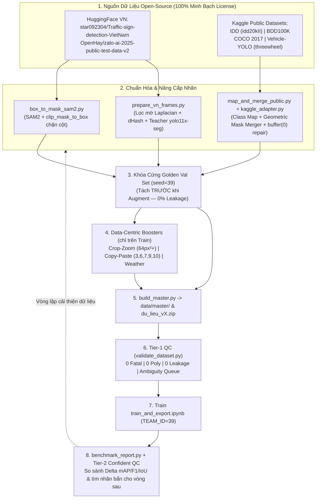

# Tổng Hợp Chiến Lược Dữ Liệu, Phân Tích Từ Benchmark BTC & Hướng Dẫn Bổ Sung Dataset Kaggle

> Tài liệu này tổng hợp đầy đủ cơ sở lý luận kỹ thuật để **giải quyết bài toán Data-Centric**, làm **tài liệu minh bạch nguồn dữ liệu** và **nội dung cốt lõi cho bài thuyết trình lúc 11:30 ngày 28/11** của **Đội 34 – Nguyễn Bá Duy (`TEAM_ID = 39`)**.

---

## Phần 1: Suy Luận Vấn Đề Từ Benchmark & Hợp Đồng BTC (`BTC Baseline Run` + `detscore`)

Khi phân tích báo cáo chạy thử mặc định trên cấu trúc của BTC (`BTC Baseline Run` dùng `yolo26n-seg`, `imgsz=640`, `epochs=60`, `seed=39`) kết hợp với mã nguồn máy chấm (`detscore v0.2.0`), ta rút ra **5 vấn đề cốt lõi** quyết định trực tiếp điểm số $\text{100} \times \text{mask mAP}@[.5:.95]$:

| # | Phát hiện từ Benchmark & Contract BTC | Hệ quả nếu chỉ train mặc định | Giải pháp Data-Centric tương ứng của Đội 34 |
| :-: | :--- | :--- | :--- |
| **1** | **Khoảng trống dữ liệu thực tế (`sample_data`)**: Bộ mẫu chỉ có `10` ảnh vẽ tổng hợp (`8` train / `2` val); tập val mặc định thiếu cả lớp `Cyclist`, không có ảnh thật, không có đêm/mưa/đông đúc. | Mô hình mặc định học từ COCO pretrained không nhận ra bối cảnh đường Việt Nam (dòng xe máy ken đặc, xe ba gác, biển báo VN). | Kết hợp **3 tầng nguồn mở**: Giao thông VN (`OpenHay` dashcam + `star092304` biển báo VN) + Đông đúc châu Á (`IDD`) + Thời tiết đêm/mưa (`BDD100K`) + Khóa cứng **Golden Val Set** đủ `11/11` lớp. |
| **2** | **Chênh lệch lớn `mAP50 (0.7948)` vs `mAP50-95 (0.5959)` (`-20 điểm`) & `Box IoU (0.8913)` vs `Mask IoU (0.8268)`**: Điểm chính thức lấy trung bình tới `IoU = 0.95` trên prototype `160×160` (`4×4 px/ô` ở thang `640`). | Nhãn polygon thô, hộp chữ nhật, hoặc mask tràn cột/chân gây trượt toàn bộ ngưỡng `IoU 0.75–0.95`, kéo tụt `AP75` và tổng điểm. | Dùng **SAM 2 (`sam2_b.pt`)** nâng cấp nhãn hộp với thuật toán **`clip_mask_to_box`** chống tràn cột, và trích contour độ phân giải cao (`approxPolyDP epsilon=0.0015`) + sửa tự cắt `buffer(0)`. |
| **3** | **Sụp đổ lớp hiếm & nhầm cặp lớp tương đồng**: Trong benchmark BTC, `Other vehicle` đạt `AP=0.0000`, `Sign` đạt `F1=0.00 @0.25`, `Cyclist` bị nhầm **5/5 (100%)** sang `Motorcyclist`, `Truck` (`0.1873`) nhầm sang `Bus`. | `yolo26n-seg` (`2.7M params`) dễ bị lớp đa số (`Car`, `Motorcyclist`) áp đảo; các lớp `3, 6, 7, 9, 10` bị quên hoàn toàn. | Dùng **IDD** (`autorickshaw -> 3`) + **Vehicle-YOLO** (`threewheel -> 3`) + **Horizon-Aware Instance Copy-Paste** cho lớp `3, 6, 7, 9, 10` + **Crop-Zoom** cho vật thể nhỏ quanh ngưỡng `64 px² @ 640`. |
| **4** | **Xung đột quy ước gộp người + xe 2 bánh (`497 RIDER_LEAK` ở V1)**: Dataset công khai & Teacher COCO đều tách `person/rider` khỏi `motorcycle/bicycle`, khiến V1 có `727 Motorcycle` nhưng chỉ `80 Motorcyclist`. | Mô hình học gán nhãn rời (`4 + 8`) thay vì gộp 1 instance duy nhất (`5`), mất trắng điểm ở lớp xuất hiện nhiều nhất trên đường VN. | Viết **Geometric Mask Merger** gộp mọi người ngồi trên cùng 1 xe (cả chở đôi/ba) thành 1 mask `5`/`7`, kiểm tra đồng thời `mask IoU` lẫn `bbox IoU + above_mounted`. |
| **5** | **Giao thoa Confidence TP (`0.77`) vs FP (`0.52`) & Trần `max_det = 100`, `conf = 0.001`**: Mỗi ảnh chỉ lấy tối đa `100` dự đoán cao nhất; FP nền (`conf ~0.46`) làm `Precision` tụt còn `0.72 @0.25`. | Cảnh ngã tư VN đông đúc có nhiều biển quảng cáo/đèn đường dễ đẩy vật thể thật ra ngoài top-100 hoặc kéo tụt Precision đầu đường cong PR. | Thêm **ảnh nền rỗng (empty `.txt`)** / **Hard Negatives** + lọc mảnh vụn `< 32–40 px² @640` + **Tier-2 Confident Learning QC** dọn nhãn thiếu/sai lớp. |

---

## Phần 2: Kiến Trúc Luồng Thu Thập & Xử Lý Dữ Liệu Hiện Tại

---

## Phần 3: Danh Mục Các Bộ Dữ Liệu Open-Source (Link, License, Lý Do & Cách Xử Lý)

| # | Tên Bộ Dữ Liệu | Link URL Cụ Thể | Giấy Phép (License) | Lý Do Chọn Cho Bài Toán VN | Cách Xử Lý Trong Dự Án |
| :-: | :--- | :--- | :--- | :--- | :--- |
| **1** | **Vietnamese Traffic Sign Detection** (`star092304`) | https://huggingface.co/datasets/star092304/Traffic-sign-detection-VietNam | Open-source | >10.000 ảnh biển báo đường bộ **thực tế Việt Nam** từ dashcam (màu sắc, chữ Việt, kích thước nhỏ). Giải quyết điểm yếu `Sign AP` thấp. | Đọc Parquet/YOLO BBox → map về `9 = Sign` → chạy **SAM 2 (`sam2_b.pt`) + `clip_mask_to_box`** ôm sát mặt biển (không dính cột) + **Crop-Zoom** giữ diện tích `>= 64 px² @640`. |
| **2** | **Zalo AI / OpenHay VN Dashcam Frames** | https://huggingface.co/datasets/OpenHay/zalo-ai-2025-public-test-data-v2 | Open-source / Research | Ảnh góc nhìn ngang từ xe hơi tại Việt Nam: dòng xe máy dày đặc, người chở hàng, ngã tư đông, ban đêm. | Lọc ảnh mờ (Laplacian) & trùng (`dhash64`) → Teacher **`yolo11x-seg`** (`imgsz=1280`) gán nháp → **Geometric Mask Merger** gộp `4+8 -> 5`, `6+8 -> 7` + `buffer(0)` sửa đa giác tự cắt. |
| **3** | **India Driving Dataset (IDD — `idd20kII`)** | https://www.kaggle.com/datasets/theainerd/indian-driving-dataset | Academic / Research | Giao thông hỗn hợp châu Á sát với Việt Nam nhất (mật độ 2 bánh cực cao, ít vạch kẻ). Có sẵn lớp **`autorickshaw`** (xe ba bánh) rất cần cho **`3 = Other vehicle`**. | Parse `*_gtFine_polygons.json` theo đúng cặp `(thư_mục_seq, tên_file)` → map `autorickshaw -> 3`, gộp `rider + motorcycle/bicycle -> 5/7`. |
| **4** | **BDD100K (Berkeley DeepDrive)** | https://www.kaggle.com/datasets/solarmainframe/bdd100k *(hoặc `marquis03/bdd100k-images`)* | BDD100K License (Research/Edu) | Bổ sung mạnh các cảnh **đêm tối, mưa, sương mù, đèn pha lóa** mà dữ liệu ngày thiếu. | Lọc tập trung subset `timeofday=night` & `weather=rainy/foggy` → nếu bản `poly2d` thì map trực tiếp; nếu bản `box2d`/YOLO thì chạy **SAM 2 + Mask Merger** (`motor -> 4`, `bike -> 6`). |
| **5** | **Vehicle Dataset for YOLO** *(Khuyến nghị bổ sung từ Kaggle)* | https://www.kaggle.com/datasets/nadinpethiyagoda/vehicle-dataset-for-yolo | Open-source / Public | Bổ sung chuyên biệt **`threewheel`** (`-> 3 Other vehicle`), **`van`** (`-> 0 Car`), `motorbike`, `bus`, `truck` ở góc nhìn cận cảnh/đa dạng. | Chạy qua **`kaggle_adapter.py`** (YOLO BBox → remap `threewheel:3, van:0, motorbike:4`) → chạy **SAM 2** chuyển thành mask đa giác chuẩn → đưa vào ngân hàng **Copy-Paste** lớp `3`. |
| **6** | **COCO 2017 (Traffic Subset)** | https://www.kaggle.com/datasets/awsaf49/coco-2017-dataset | CC BY 4.0 | Số lượng lớn instance chuẩn pixel-level cho `car`, `bus`, `truck`, `bicycle`, `motorcycle`, `traffic light`, `stop sign` để ổn định đặc trưng gốc. | Lọc chỉ giữ ảnh có phương tiện/đèn giao thông ngoài đường, chạy **Geometric Mask Merger** gộp `person + motorcycle/bicycle -> 5/7`. |
| **7** | **Vietnam Traffic Sign (VNTS)** *(Dự phòng mở rộng)* | https://huggingface.co/datasets/thanhhiepvos/vietnam_traffic_sign | Open-source / Academic | Bổ sung thêm biến thể biển báo cấm/chỉ dẫn Việt Nam nếu muốn tăng độ phủ lớp `9`. | Dùng cùng pipeline `Parquet/YOLO BBox -> SAM 2 -> Crop-Zoom`. |

> [!CAUTION]
> **Nhắc nhở quy định cuộc thi**: Khi thuyết trình lúc 11:30 ngày 28/11, mọi nguồn thực sự dùng để train phiên bản nộp cuối cùng phải được giữ nguyên bản ghi trong `datasets_registry.md` (tên, URL, giấy phép, số ảnh train/val, cách ánh xạ).

---

## Phần 4: Hướng Dẫn Bổ Sung & Xử Lý Bất Kỳ Bộ Dữ Liệu Mới Nào Trên Kaggle

Khi bạn tìm được thêm một dataset giao thông hay trên Kaggle (ví dụ xe ba gác/xích lô, xe buýt/xe tải, biển báo, người đi bộ ban đêm), quy trình xử lý chuẩn gồm **4 bước gọn nhẹ**:

1. **Kiểm tra 3 tiêu chí nhận vào (Gate lọc trước khi tải)**:
   - **Góc nhìn (Viewpoint)**: Phải là ảnh chụp từ **tầm mắt ngang / camera hành trình (dashcam / street-level)**; **LOẠI BỎ** dataset chụp từ drone/camera giao thông trên cột quá cao (như `UIT-ADrone`) vì làm lệch phối cảnh của Robotaxi.
   - **Độ phân giải**: Tối thiểu cạnh ngắn `>= 480 px` (tránh ảnh thumbnail vỡ hạt làm mất biên mask `mAP@[.5:.95]`).
   - **Giấy phép**: Công khai rõ ràng (CC BY, MIT, Apache, Academic/Research).
2. **Xác định định dạng gốc & đưa qua `kaggle_adapter.py`**:
   - **Nhóm A — Đã có Mask (`COCO JSON`, `YOLO Seg`, `IDD gtFine`, `BDD poly2d`)**: Không cần SAM 2; chỉ cần khai báo bảng ánh xạ tên lớp vào `configs/class_mapping.yaml` → chạy `Geometric Mask Merger` + `buffer(0)` sửa đa giác.
   - **Nhóm B — Chỉ có Bounding Box (`YOLO BBox 5 cột`, `BDD box2d`, `Pascal VOC .xml`)**: Tự động truyền các box đã remap qua **SAM 2 (`sam2_b.pt`) + `clip_mask_to_box`** để chuyển thành polygon ôm sát biên (tránh dính cột biển báo hay nền).
   - **Nhóm C — Ảnh/Video thô chưa có nhãn (VD video dashcam VN trên YouTube/Kaggle)**: Qua `prepare_vn_frames.py` (lọc mờ + lọc trùng `dhash64`) → Teacher `yolo11x-seg` gán nháp → `Geometric Mask Merger` → **bắt buộc người duyệt sửa** riêng các ca `3 = Other vehicle`, `1 = Bus (16+ chỗ)` và tách `2/3` đầu kéo–rơ-moóc.
3. **Kiểm tra 5 bẫy quy ước trước khi gộp vào `data/master/`**:
   - Đảm bảo dataset mới **KHÔNG** mang theo nhãn `van 9-15 chỗ -> Bus`, **KHÔNG** gộp đầu kéo + container vào `Truck`, **KHÔNG** để rời `person + motorcycle` chưa gộp, và **KHÔNG** khoanh cột biển báo vào `Sign`.
4. **Chạy QC Tầng 1 (`validate_dataset.py`) → Cập nhật `datasets_registry.md` → Chạy `benchmark_report.py`** trên Golden Val cố định để xác nhận tập dữ liệu mới đó thực sự làm **tăng `100 × mask mAP@[.5:.95]`** (nếu làm tụt điểm trên Golden Val thì loại bỏ ngay!).
