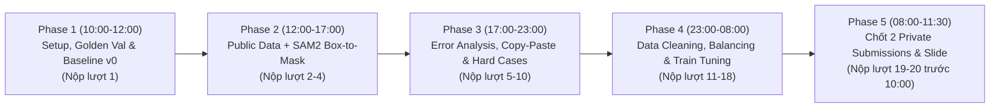

# Kế Hoạch Chi Tiết & Lộ Trình Giải Bài Toán AIInAction RoboTaxi Data Centric Competition

## Goal Description

Xây dựng bộ dữ liệu huấn luyện **100% từ nguồn dữ liệu mở (open-source) hợp lệ** kết hợp quy trình lặp **Data-Centric** tối ưu nhất cho bài toán **Instance Segmentation giao thông Việt Nam (11 lớp)** trên mô hình cố định **`yolo26n-seg`** (`imgsz = 640`), xuất **`model.onnx` (FP32, ≤ 42 MB)** để tối đa hóa điểm số trên Public & Private Leaderboard trong ~24 giờ (đóng nộp bài lúc **10:30 ngày 28/11/2026**).

### Ràng buộc kỹ thuật & thể lệ cốt lõi
- **Mô hình cố định**: `yolo26n-seg` (Ultralytics YOLO26 Nano, NMS-free dual-head, không DFL), `imgsz = 640`, xuất ONNX FP32 (`model.onnx` duy nhất trong `.zip` ≤ 42 MB).
- **Lượt nộp**: Tối đa **20 lượt** (mỗi thời điểm chỉ chấm 1 bài; chọn tối đa **2 bài** tính điểm Private trước 10:30 28/11).
- **Tính minh bạch dữ liệu (Bắt buộc cho thuyết trình 11:30 28/11)**: Mọi bộ dữ liệu công khai sử dụng đều phải ghi nhận: *tên, URL, giấy phép (license), số ảnh đã dùng, và cách ánh xạ (mapping) về 11 lớp*.

---

## User Review Required

> [!IMPORTANT]
> Trước khi tôi tạo mã nguồn và các script tự động hóa trong workspace `c:\Users\basduy05\Downloads\VINAI\hackathon`, bạn vui lòng xác nhận 3 thông tin ở phần **Open Questions** bên dưới để tôi điều chỉnh pipeline cho sát với phần cứng và nhân lực của đội.

## Open Questions

1. **Dữ liệu mẫu & Notebook mẫu**: Bạn đã tải bộ dữ liệu mẫu (`du_lieu.zip`) và notebook mẫu từ tab *Dữ liệu* của ban tổ chức chưa?
2. **Tài nguyên GPU**: Đội bạn đang train trên môi trường nào (Google Colab Free/Pro, Kaggle T4x2/P100, hay GPU thuê/local)?
3. **Nhân lực & Công cụ gán/duyệt nhãn**: Đội có bao nhiêu thành viên tham gia duyệt nhãn và các bạn dùng công cụ nào (X-AnyLabeling, CVAT, Roboflow, hay Label Studio)?

---

## Nghiên Cứu Bộ Dữ Liệu Open-Source & Bảng Ánh Xạ 11 Lớp

Để giải quyết bài toán giao thông Việt Nam (xe máy dày đặc, ba gác/xích lô, biển báo VN, đêm/mưa) mà vẫn đảm bảo **100% open-source, minh bạch license**, ta kết hợp **3 tầng dữ liệu** bổ trợ lẫn nhau:

### 1. Danh mục Public Datasets đề xuất (Đã kiểm tra nguồn & License)

| Tầng | Tên Bộ Dữ Liệu | Nguồn / URL | Giấy phép (License) | Dạng nhãn gốc | Điểm mạnh đặc thù cho bài toán |
| :--- | :--- | :--- | :--- | :--- | :--- |
| **1. Giao thông VN (Domain-Exact)** | **Vietnam Road Signs (VNTS) / Zalo AI Traffic Sign** (`thanhhiepvos/vietnam_traffic_sign`, `star092304/Traffic-sign-detection-VietNam`) | [HuggingFace](https://huggingface.co/datasets/thanhhiepvos/vietnam_traffic_sign) / Kaggle / [GitHub Zalo](https://github.com/buiduchanh/zalo_traffic_detection) | Open-source / Academic | Bounding Box | Biển báo Việt Nam thực tế từ dashcam, góc nhỏ, ánh sáng VN → dùng **SAM 2** chuyển từ Box sang Mask mặt biển (`9 = Sign`). |
| **1. Giao thông VN (Domain-Exact)** | **Roboflow Vietnam Traffic** (`viet-nam-traffic` & các bộ VN Traffic mở) | [Roboflow Universe](https://roboflow.com) | **CC BY 4.0** | BBox / Polygon | Chứa xe máy, ô tô, xe buýt, xe tải đúng bối cảnh đường phố Việt Nam. |
| **1. Giao thông VN (Ảnh thô Dashcam)** | **Zalo AI / OpenHay VN Dashcam** (`OpenHay/zalo-ai-2025-public-test-data-v2`) | [HuggingFace](https://huggingface.co/datasets/OpenHay/zalo-ai-2025-public-test-data-v2) | Open-source / Research | Video / Frames | Góc nhìn ngang ngang tầm xe hơi (đúng góc nhìn Robotaxi!), nhiều cảnh ngã tư đông xe máy, đêm, mưa → chạy **Teacher Pseudo-Labeling**. |
| **2. Đông đúc & Phương tiện lạ (SEA/South Asia)** | **India Driving Dataset (IDD — IIIT Hyderabad)** | [IDD Official](http://idd.insaan.iiit.ac.in/) / Kaggle | Academic / Research | **Instance Segmentation** | Mật độ xe máy cực cao, giao thông hỗn hợp gần giống VN nhất. Có sẵn lớp **`auto-rickshaw`** (map sang `3 = Other vehicle`) và tách **`rider`**. |
| **3. Chuẩn Segmentation & Thời tiết khắc nghiệt** | **Mapillary Vistas (v1.2 / v2.0)** | [Mapillary](https://www.mapillary.com/dataset/vistas) / HuggingFace | **CC BY-NC-SA 4.0** | **Instance Segmentation** | Mask đa giác cực mịn. Có sẵn lớp **`motorcyclist`**, **`bicyclist`**, **`traffic sign (front/back)`** (chỉ mặt biển!), **`traffic light`** (cả hộp đèn!). |
| **3. Thời tiết khắc nghiệt** | **BDD100K (Instance Segmentation subset)** | [bdd100k/bdd100k](https://github.com/bdd100k/bdd100k) | **BDD100K License** (Research/Edu) | **Instance Segmentation** | Rất mạnh về **ban đêm, mưa, sương mù, lóa đèn pha** — bù đắp điểm yếu thiếu ảnh đêm/mưa của các bộ khác. |
| **3. Bổ sung nền** | **COCO 2017 (Traffic subset)** | [cocodataset.org](https://cocodataset.org) | **CC BY 4.0** | **Instance Segmentation** | Số lượng lớn `car`, `bus`, `truck`, `person`, `motorcycle`, `bicycle`. *Bắt buộc lọc ảnh đường phố & gộp mask người+xe.* |

> [!WARNING]
> **Không nên dùng `UIT-ADrone`**: Dù là bộ dữ liệu giao thông Việt Nam nổi tiếng, UIT-ADrone quay từ **drone trên cao (bird's-eye view)**, khác hoàn toàn góc nhìn ngang từ mặt đường của **Robotaxi**. Đưa vào tập train sẽ gây lệch phân phối góc nhìn (viewpoint shift) và làm giảm độ chính xác của `yolo26n-seg`.

### 2. Ma trận ánh xạ (Class Mapping) sang 11 lớp chuẩn của cuộc thi

| ID | Lớp mục tiêu | Mapillary Vistas | IDD | BDD100K | COCO | Ghi chú xử lý Edge Case |
| :-: | :--- | :--- | :--- | :--- | :--- | :--- |
| `0` | **Car** | `car` | `car` | `car` | `car` | Lưu ý xe 9–15 chỗ ở VN thuộc `Car`, không map sang `Bus`. |
| `1` | **Bus** | `bus` | `bus` | `bus` | `bus` | Chỉ xe ≥ 16 chỗ. |
| `2` | **Truck** | `truck` | `truck` | `truck` | `truck` | Nếu là đầu kéo có rơ-moóc, **tách phần rơ-moóc sang `3`**. |
| `3` | **Other vehicle** | `other-vehicle`, `trailer`, `caravan` | `auto-rickshaw`, `caravan`, `vehicle fallback` | `trailer` (nếu có) | *(hiếm)* | Bổ sung thêm ảnh ba gác, xích lô, xe công trình VN + Copy-Paste. |
| `4` | **Motorcycle** | `motorcycle` | `motorcycle` *(khi không có rider)* | `motorcycle` *(không rider)* | `motorcycle` *(không person)* | Chỉ xe máy **không có người ngồi** (đỗ hoặc đang dắt). |
| `5` | **Motorcyclist** | `motorcyclist` | **`rider` + `motorcycle`** (gộp mask) | **`rider` + `motorcycle`** (gộp mask) | **`person` + `motorcycle`** (gộp mask) | **1 polygon duy nhất** phủ cả xe + mọi người ngồi trên xe. |
| `6` | **Bicycle** | `bicycle` | `bicycle` *(khi không có rider)* | `bicycle` *(không rider)* | `bicycle` *(không person)* | Chỉ xe đạp **không có người đi**. |
| `7` | **Cyclist** | `bicyclist` | **`rider` + `bicycle`** (gộp mask) | **`rider` + `bicycle`** (gộp mask) | **`person` + `bicycle`** (gộp mask) | **1 polygon duy nhất** phủ cả xe đạp + người đi. |
| `8` | **Pedestrian** | `person` | `person` | `pedestrian` | `person` *(không ngồi trên xe)* | Bao gồm cả **người đang dắt xe** (khi đó xe là `4` hoặc `6`). |
| `9` | **Sign** | `traffic-sign (front/back)` | `traffic sign` | `traffic sign` | `stop sign` (+ VNTS/Zalo) | **Chỉ mặt biển, KHÔNG phủ cột.** |
| `10` | **Traffic light** | `traffic-light` | `traffic light` | `traffic light` | `traffic light` | **Phủ CẢ hộp đèn**, không chỉ bóng sáng, không phủ cột. |

---

## Giải Pháp Kỹ Thuật: Nhận Diện Chính Xác & Nhanh Với Nhiều Edge Cases VN

Vì mô hình suy luận bị khóa cố định là **`yolo26n-seg` (`imgsz=640`)**, tốc độ inference đã rất nhanh (nhờ kiến trúc Nano NMS-free, không DFL). Do đó, bài toán **"nhanh và chính xác"** nằm ở hai khía cạnh:
1. **Nhanh trong khâu tạo & chuẩn hóa dữ liệu sạch** (trong 24 giờ hackathon).
2. **Chính xác trong nhận diện các edge cases khó** trên một mô hình dung lượng nhỏ (`yolo26n-seg`).

### 1. Pipeline "Box-to-Mask" siêu tốc với SAM 2
Các bộ dữ liệu Việt Nam tốt nhất hiện có (VNTS, Zalo Traffic Sign, Roboflow VN) đa phần chỉ có **Bounding Box**. Ta nâng cấp chúng thành **YOLO-seg polygon** tự động:
- Dùng `ultralytics.SAM("sam2_b.pt")` nhận đầu vào là `bboxes` có sẵn từ nhãn gốc.
- **Lợi thế cực lớn cho Edge Case**: Với biển báo (`9 = Sign`) và đèn giao thông (`10 = Traffic light`), khi đưa bounding box khít mặt biển/hộp đèn vào SAM 2, mask sinh ra sẽ ôm sát mặt biển/hộp đèn và **tự động loại bỏ phần cột**!

### 2. Thuật toán Geometric Mask Merger (Giải quyết bẫy `4 vs 5` và `6 vs 7`)
Khi lấy dữ liệu từ COCO, BDD100K, IDD, ta **không được phép** map thô `person/rider` sang `Pedestrian`. Script `map_and_merge_public.py` sẽ tự động chạy logic:
- Với mỗi mask `person`/`rider` ($M_p$) và mask `motorcycle`/`bicycle` ($M_v$):
  - Tính tỷ lệ giao cắt chuẩn hóa theo diện tích người/xe và kiểm tra điều kiện hình học (tâm $M_p$ nằm phía trên hoặc bên trong vùng mở rộng theo trục tung của $M_v$, phần giao giữa bbox $M_p$ và bbox $M_v$ vượt ngưỡng).
  - Nếu đạt ngưỡng cao → tự động **Union (hợp nhất) hai mask** thành 1 polygon duy nhất (`5 = Motorcyclist` hoặc `7 = Cyclist`) và **xóa** mask `person`/`motorcycle` rời rạc cũ.
  - Nếu nằm ở vùng ngưỡng mập mờ (ví dụ người đứng rất sát xe đang đỗ hoặc đang dắt xe) → đẩy vào **Ambiguity Queue** để thành viên đội duyệt nhanh bằng mắt.

### 3. Chiến lược tối ưu cho `yolo26n-seg` ở `imgsz = 640` với Edge Cases VN
- **Small Object Preservation (Biển báo, Đèn giao thông, Người đi bộ xa)**:
  - Khi resize ảnh dashcam FullHD (1920x1080) xuống `640x640`, biển báo có thể chỉ còn `6x6` px.
  - **Giải pháp**: Tạo dữ liệu **Multi-scale Crop-Zoom** cho tập train (cắt các vùng `800x800` hoặc `960x960` chứa biển báo, đèn giao thông, xe ba gác, xe máy đông đúc rồi đưa vào tập train). Mô hình vẫn train và infer ở `imgsz=640`, nhưng được học đặc trưng chi tiết của vật thể nhỏ rõ nét hơn.
- **Tách Đầu Kéo & Rơ-moóc (`2 = Truck` vs `3 = Other vehicle`) + Lớp hiếm**:
  - Thu thập ~100–200 ảnh đầu kéo container, xe ba gác, xích lô tại VN; dùng SAM 2 + sửa tay để tách rạch ròi cabin đầu kéo (`2`) và container/rơ-moóc (`3`).
  - Dùng **Instance Copy-Paste** (`augment_copypaste.py`) nhân bản các instance chuẩn của lớp `3 = Other vehicle`, `6 = Bicycle`, `7 = Cyclist`, `10 = Traffic light` lên nhiều nền đường phố VN ngày/đêm/mưa.
- **Ánh sáng cực đoan (Đêm, Mưa, Nắng gắt)**:
  - Kết hợp ảnh đêm/mưa từ **BDD100K** + ảnh dashcam đêm VN + **Weather Augmentation** (giọt mưa trên kính, motion blur, giảm gamma/lóa đèn pha).
- **Hard Negative Mining**:
  - Thêm các ảnh đường phố không có đối tượng (kèm file `.txt` rỗng) hoặc chứa các vật dễ gây nhận nhầm (bảng quảng cáo giống biển báo, đèn đường giống đèn giao thông) để giảm False Positives.

---

## Kiến Trúc Workspace Dự Án

Khi bạn duyệt kế hoạch, tôi sẽ khởi tạo cấu trúc sau trong `c:\Users\basduy05\Downloads\VINAI\hackathon`:

```text
hackathon/
├── research-state.yaml          # Theo dõi các vòng lặp dữ liệu & điểm Val / Public LB
├── findings.md                  # Ghi nhận lỗi phát hiện ở mỗi vòng và cách khắc phục
├── datasets_registry.md         # Bảng kê khai MỌI public dataset (tên, URL, license, số ảnh, mapping)
└── src/
    ├── validate_dataset.py      # Kiểm tra toàn bộ edge cases YOLO-seg & thống kê phân bố
    ├── map_and_merge_public.py  # Ánh xạ Mapillary/IDD/BDD100K/COCO + gộp person+bike
    ├── box_to_mask_sam2.py      # Chuyển BBox datasets VN (VNTS, Zalo, Roboflow) -> YOLO-seg bằng SAM2
    ├── error_analysis.py        # Đánh giá Golden Val: AP từng lớp, confusion matrix, tìm hard cases
    ├── augment_copypaste.py     # Copy-Paste lớp hiếm (3, 6, 7, 9, 10) & weather augmentation
    └── export_verify_onnx.py    # Xuất yolo26n-seg -> model.onnx (FP32, 640), check <= 42MB & test infer
```

---

## Lộ Trình Thực Hiện Chi Tiết (24 Giờ: 27/11 – 28/11)



- **Phase 1 (10:00 – 12:00, 27/11)**: Tải dữ liệu mẫu & notebook mẫu → kiểm tra chuẩn nhãn mẫu → tạo **Golden Validation Set** cố định → train `Baseline v0` → export `model.onnx` & **nộp lượt 1** xác nhận pipeline hợp lệ.
- **Phase 2 (12:00 – 17:00, 27/11)**: Tải & chuẩn hóa **Mapillary Vistas + IDD + BDD100K + COCO traffic** (`map_and_merge_public.py`), chạy **SAM 2** chuyển đổi **VNTS/Zalo/Roboflow VN** (`box_to_mask_sam2.py`), pseudo-label thêm ảnh dashcam VN, duyệt tay edge cases → train **Iteration 1** → **nộp lượt 2–4**.
- **Phase 3 (17:00 – 23:00, 27/11)**: Chạy `error_analysis.py` trên Golden Val → xác định lớp yếu/cặp nhầm → thực hiện **Crop-Zoom** (cho biển báo/đèn) + **Copy-Paste** (cho ba gác, xích lô, xe đạp, đầu kéo/rơ-moóc) + **Weather Augmentation** → train **Iteration 2–3** → **nộp lượt 5–10**.
- **Phase 4 (23:00 27/11 – 08:00 28/11)**: Dùng model tốt nhất quét tìm **nhãn bẩn / nhãn thiếu** trong tập Train (Confident Learning) → lọc/sửa sạch → cân bằng tỷ lệ ngày/đêm/mưa và lớp hiếm → tinh chỉnh hyperparameters `yolo26n-seg` (`mosaic`, `close_mosaic`, `copy_paste`, `lr0`, `epochs`) → **nộp lượt 11–18**.
- **Phase 5 (08:00 – 11:30, 28/11)**: Chốt lượt nộp dự phòng cuối **trước 10:00** (tránh nghẽn hàng đợi) → chọn **2 bài tốt nhất cho Private** (1 bài Public cao nhất + 1 bài Golden Val ổn định nhất) trước `10:30` → hoàn thiện slide thuyết trình (kèm bảng `datasets_registry.md` + minh họa xử lý edge cases + biểu đồ tiến trình) trước `11:30`.

---

## Verification Plan

### Automated Tests
1. **Kiểm tra định dạng & edge cases dữ liệu**:
   ```bash
   python src/validate_dataset.py --data-dir <path_to_dataset>
   ```
   Xác nhận 0 lỗi tọa độ ngoài `[0, 1]`, 0 polygon `< 3` đỉnh, 100% ảnh có file `.txt` (kể cả rỗng), class ID thuộc `0..10`.
2. **Kiểm tra mô hình ONNX trước khi nộp**:
   ```bash
   python src/export_verify_onnx.py --weights <best.pt> --imgsz 640 --max-mb 42
   ```
   Xác nhận `model.onnx` ở FP32, dung lượng `<= 42 MB`, input `(1, 3, 640, 640)`, chạy inference thành công qua `onnxruntime`.

### Manual Verification
- Kiểm tra trực quan tối thiểu 50 ảnh sau khi chạy `map_and_merge_public.py` và `box_to_mask_sam2.py` để xác nhận không gộp sai `4 vs 5`, `2 vs 3`, `9`, `10`.
- Kiểm tra dự đoán của `model.onnx` trên ảnh test khó (đêm, mưa, ba gác, đầu kéo container, ngã tư đông xe máy) trước khi nộp.
